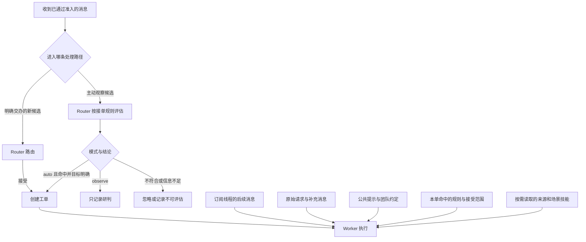

# 提示词与接单规则配置说明

## 按作用选择位置

| 想控制的事情 | 配置位置 | 谁会读取 | 生效范围 |
|---|---|---|---|
| 接哪些群、哪些人、何时需要提及 | 设置 → 来源、评估中的来源准入 | 宿主先检查 | 决定消息如何进入；这些检查有程序约束 |
| 关注与忽略关键词 | 设置 → 来源 → 飞书 | 宿主先检查 | 新任务候选的文字过滤，忽略优先 |
| 哪些消息值得主动发起工作 | 设置 → 评估 → 接单规则 | Router；命中的规则也传给 Worker | 主动候选判断、所接任务的范围与附带要求 |
| 通用语言、回复方式、打扰频率 | 更多设置 → 团队约定 → 沟通方式 | Router 与 Worker | 所有任务 |
| 通用自主程度、任务边界、关键提问条件 | 更多设置 → 团队约定 → 工单范围 | Router 与 Worker | 所有任务；实际权限仍由宿主检查 |
| 通用结果格式、验证与来源要求 | 更多设置 → 团队约定 → 交付要求 | Router 与 Worker | 所有任务 |
| 翻译、项目调研、知识库维护等详细流程 | 更多设置 → 技能 → 添加技能 | Router 与 Worker 可按需加载 | 技能写明的场景，不自动套用到所有任务 |
| 角色、订阅、派工、回复和报告协议 | 更多设置 → 内置段落 | 按段落所属角色 | 通常保留默认；修改意味着覆盖这一整段 |
| 这一次任务的特殊目标或限制 | 交办消息及后续补充 | 处理该工单的 Worker | 当前工单 |

提示词规定 Agent 的行为预期。工具是否允许调用、消息是否符合准入、应用能否访问某个文档，仍由宿主工具与平台权限决定。写入“允许读所有文档”无法增加飞书应用权限。

## 团队约定：每次请求都会带上的共通要求

“沟通方式、工单范围、交付要求”三个段落都会进入 Router 和 Worker 的系统提示。适合写所有任务共用的要求，保持简短。

例如，沟通方式可以写“默认中文，确认请求一次，普通进度留在任务记录中”；工单范围可以写“在已配置权限内自动执行，方法自行选择，缺少关键目标或授权时说明具体问题”；交付要求可以写“提供真实交付链接、保留来源，说明会影响使用的验证限制”。

这里填写某一类任务的完整流程，会占用每个任务的上下文并影响其他任务。场景流程放到技能里，并写清适用条件。

## 内置段落：Agent 之间的协作协议

| 内置段落 | 读取角色 | 用途 |
|---|---|---|
| 共享约定 `runtime/shared` | 两者 | Router 负责判断与交接，Worker 负责调查、执行和验证 |
| 主 Session 角色 `runtime/orchestrator` | Router | 常驻路由职责、后续消息处理与等待方式 |
| 执行器角色 `runtime/worker` | Worker | 单个工单的目标、范围和交付职责 |
| 订阅 `runtime/subscriptions` | 两者 | 线程如何持续向工单提供消息、何时恢复工作 |
| 回复 `runtime/replies` | 两者 | 确认、结果、直接回答和人工问题的消息协议 |
| 派工 `runtime/dispatch` | Router | 接新单、关联、停止、忽略，以及防止重复转发 |
| 执行 `runtime/work` | Worker | 原文读取、范围核实、后续消息处理、执行与报告 |
| 主动评估 `runtime/admission` | Router | 如何读上下文、核实意图、逐条判断接单规则 |
| 主会话交接 `runtime/handoff/orchestrator` | Router | 及时转达人需要决定的问题，避免重复通知 |
| 执行器交接 `runtime/handoff/worker` | Worker | 提交、更新和清除结构化人工问题 |
| 执行环境 `runtime/environment` | 两者 | 宿主填入任务目录、配置账号等环境变量 |
| 策略模板 `runtime/policy`、`runtime/policy/none` | Router | 宿主填入当前策略版本、主动模式和已启用规则 |
| 飞书、GitHub 技能 `skill/feishu`、`skill/github` | 按需加载 | 来源读取与操作协议，见下文 |

执行环境与策略模板中的占位符由宿主填充，编辑时需保留面板标明的占位符。工具名、字段名和状态值也要保持协议一致，例如 `orchestrator_report`、`human_action`、`ready`。

接单条件可以直接在评估页编辑。具体业务流程可以添加技能。通常无需修改内置评估协议或整个 Worker 角色。

## 技能：按场景补充操作说明

技能是可被读取的说明文本。插件将技能名称和简介注册到 Router 与 Worker 的会话技能范围中，Agent 根据任务按需加载正文。正文不会全部拼进每次请求的系统提示；读取后的内容会成为该会话上下文的一部分。

### 插件自带的来源技能

- **飞书**：说明如何通过工单来源引用读取原消息、根消息、线程与分页；如何用 `orchestrator_feishu_api` 操作应用有权限访问的资源；如何保留原始消息链接并交回入口回复。配置飞书机器人后注册。
- **GitHub**：说明 Issue、PR、审查和 CI 的读取方式、PR 与工单绑定、审查线程回复及来源交付。当前实现始终提供这一技能，Agent 在涉及 GitHub 的任务中按需读取。实际监听和仓库操作依赖 GitHub 配置与工具权限。

这些技能包含 SuperAgent 自身的协议与工具用法，随插件提供，用户无需在 DSH 全局重复安装。它们也不等同于一套覆盖整个平台所有 API 的技能库。

普通调研、写作等任务可直接使用宿主已有工具。飞书 API 工具由插件提供，GitHub 的 gh 等能力取决于执行环境；技能正文自身不会安装工具、建立连接或新增权限。其他已安装技能能否使用，取决于该 DSH 会话提供的技能与权限。

发布包需完整保留内置技能文件：当前加载器在启动时会读取这些资源，手动删除会导致加载失败。业务配置上无需删除技能文件来限制权限，使用来源开关和宿主权限设置即可。

### 自定义团队技能

每项技能建议包含“何时使用、目标、操作约束、验证与交付”。名称按面板要求使用小写英文字母、数字和连字符，正文可写中文。简介由正文开头提取，因此开头就写清适用场景。

示例技能 `knowledge-curation`：

> 适用于将群内推荐的技术文章和开源项目整理进飞书知识库的任务。先读取完整来源并核实是否重复；文章提取观点与证据，必要时翻译；项目说明用途、适用人群、主要能力与限制。保留原始链接、作者和日期。写入用户指定的知识库目录，按接口回执回读验证，最后报告真实文档链接。目标目录未提供或无法访问时，提出具体缺少的前提。

目标目录应填写真实链接。该技能不会自行订阅群或让所有链接都触发任务；主动触发条件在评估页另行配置。直接交办时也可以点明“按知识收录要求处理”，帮助 Worker 选择对应技能。技能选择遵循模型判断，目前没有强制将某一规则绑定某一技能的配置。

## 接单规则为何保留在“评估”

接单规则的首要用途是控制主动任务：Router 判断观察到的消息是否符合允许主动工作的条件。例如，分享链接可以只是交流，也可以按用户规则触发调研收录。

直接交办由允许人员的请求进入路由，不要求先命中主动规则；即使主动模式关闭，也可以处理明确交办。来源准入、权限以及人工停止要求仍然有效。

在主动派工时，宿主会将**命中规则的完整文本、规则 ID 和已接受范围**加入 Worker 的派工内容。原型还明确将命中规则中的流程与沟通要求，置于该工单的默认确认和消息约定之前；权限、准入和回复工具的检查仍有效。因此，把详细流程写在规则里，会同时影响判断与执行。

推荐将规则写成“何时主动做、允许做什么、什么情况忽略”，详细方法放在团队技能，通用要求放在团队约定。可以在规则里简短提及适用技能，Worker 仍需按任务加载它。

示例规则：

> 群内分享技术文章或开源项目，且附有明确推荐理由时，可以主动调研并收录；忽略广告、重复链接和无关闲聊。任务范围限于该分享主题，执行时参考知识收录技能。

规则并非每个 Worker 都会拿到的统一提示词。明确交办的新单通常不携带主动规则全文；已订阅工单的相关后续请求由原 Worker 判断，超出范围的请求交回 Router。若希望所有任务都遵守某项要求，应放进团队约定。

## 提示词如何组合与更新

每次模型请求会组合：共享约定 → 当前角色 → 三项团队约定 → 订阅和回复协议 → 本角色的派工或执行协议 → Router 的主动评估协议 → 交接协议 → 当前执行环境 → Router 当前策略。Worker 额外获得该工单的主动授权边界，并保留宿主提供的提示与适用工作区约定。

这是组装顺序。各类文字需保持一致，不能简单认为排在后面的一段可以覆盖权限或撤销原始人的明确限制。

- 编辑后先保存；完整提示词页会展示当前草稿的组合结果，未保存草稿不会生效。
- 保存后的配置用于后续模型请求；当前已发出的模型请求继续使用当时上下文。保存会通知主会话，按原型机制在后续请求更新提示与技能注册。
- 未覆盖的内置段落随插件升级使用新默认内容。已覆盖的段落保留用户文本，面板提示“默认内容已更新”，可逐段选择保留或改用新默认。
- 团队约定中已经保存的文本也会保留；需要新默认时，在对应段落恢复默认并保存。历史页可查看版本、载入旧配置，载入后还需保存才生效。
- 更新提示无法抹去会话中已经读过的历史消息、旧技能或原工单派工内容。新任务更适合验证新默认，已有任务则需同时查看原始范围与后续输入。

## 0.2.2 的默认内容调整

公共角色、主动评估与 Worker 执行说明，以及 Worker 的额外主动授权提示，均已解除“单个模块代码修改、必须创建 PR”等原型场景限制，关键业务默认说明使用中文。保留原型的工具、评估、订阅、派工、结构化报告与交接协议。

飞书技能已按应用 SDK 接入整理。GitHub 技能保留平台衔接协议，团队特定的审查轮数、自动改写提交以补充署名、固定行数阈值等做法已移除；需要的团队可自行配置适用要求。默认规则与设置提示使用通用任务示例。
